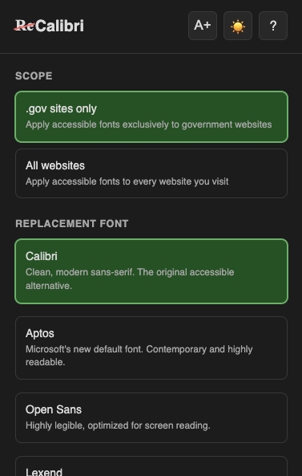

# ReCalibri

Replace Times New Roman with fonts that are actually readable.


---



In December 2025, the U.S. State Department reversed a 2023 accessibility directive that had switched government documents from Times New Roman to Calibri. The original switch was made specifically to help people with visual disabilities and dyslexia. ReCalibri puts it back.

**[Download for Chrome](https://dr.eamer.dev/downloads/recalibri)** · **[Download for Firefox](https://dr.eamer.dev/downloads/recalibri)**

---

## What it does

Detects Times New Roman on any web page and swaps it for a font you can actually read. Works on `.gov` sites by default, or everywhere if you want.

**Font options:**
- Calibri — clean, modern, what the State Dept had before the reversal
- Aptos — Microsoft's current accessibility recommendation
- Open Sans — optimized for screens
- Lexend — designed to reduce reading fatigue
- Atkinson Hyperlegible — built specifically for low vision
- OpenDyslexic — weighted letters that reduce character confusion

## Features

- Handles dynamically loaded content via MutationObserver — no page refresh needed
- Scope toggle: `.gov` only or all websites
- Light/dark mode popup with adjustable font sizes
- Full keyboard navigation, screen reader compatible
- Stores preferences locally, sends nothing anywhere

## Install

**Chrome (unpacked):**
1. Go to `chrome://extensions/`
2. Enable Developer mode
3. Click "Load unpacked" → select the `extension/` folder

**Firefox:**
1. Go to `about:debugging`
2. Click "This Firefox" → "Load Temporary Add-on"
3. Select `extension/manifest.json`

## Development

```bash
pnpm install
pnpm dev          # landing page dev server
pnpm build        # build landing page
```

Extension source is in `extension/`. It's plain JS — no build step needed.

## Project structure

```
├── client/          # React landing page (Vite + TypeScript + Tailwind)
├── extension/       # Chrome/Firefox extension (Manifest V3)
│   ├── content.js   # Font detection and replacement
│   ├── styles.css   # CSS overrides
│   └── popup/       # Settings UI
├── server/          # Backend (if applicable)
└── shared/          # Shared types/utilities
```

## Privacy

No data collection. No external requests except loading web fonts (Google Fonts, CDNFonts) when you pick Open Sans, Lexend, Atkinson, or OpenDyslexic. Preferences stay in browser storage.

## License

MIT — [LICENSE](extension/LICENSE)

## Author

**Luke Steuber** · [lukesteuber.com](https://lukesteuber.com) · [@lukesteuber.com](https://bsky.app/profile/lukesteuber.com)